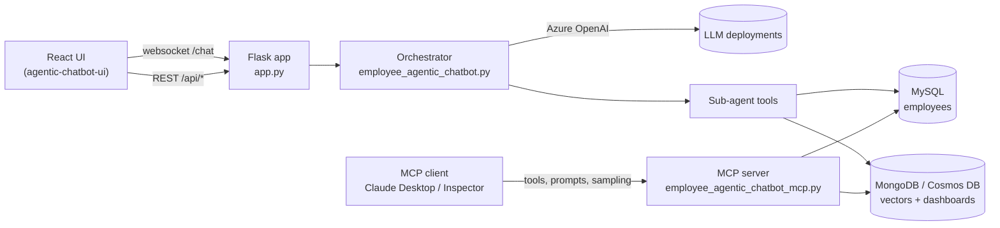

# Overview

An agentic chatbot that answers plain-English questions about a MySQL employee database. It plans each request, writes and runs SQL, remembers earlier answers, and turns results into saved, auto-generated dashboards. Enterprise rows never go to the language model.

## What it does

- **Ask in plain English.** An orchestrator model plans the steps: read the schema, look for a similar past question, write the SQL, run it, and answer.
- **Reuses past work.** Each task is stored with a vector embedding. A similar question skips SQL generation and reuses the saved query.
- **Keeps data private.** The planner receives the question, table and column names, the SQL it wrote, and a masked status. Result rows go only to the UI.
- **Builds dashboards automatically.** Each answer can become a saved Plotly chart. Dashboards re-run their SQL when opened, so the data is current.
- **Remembers the conversation.** Each chat session keeps its own memory file. The last few turns are sent back to the planner.
- **Exposes its tools over MCP.** An MCP server offers the same tools to clients such as Claude Desktop and the MCP Inspector. The server never calls a model itself. It asks the client through sampling.

# Sample Video
[](https://www.youtube.com/watch?v=b9-KitMKe50)

## Architecture



Two ways to run the same tools:

| Path | Entry point | Who calls the LLM |
|---|---|---|
| Web app | `app.py` (Flask + websocket + serves the React build) | The backend, through `employee_agentic_chatbot.py` |
| MCP server | `employee_agentic_chatbot_mcp.py` | The connected client, through MCP sampling. The server calls no model. |

## Key features by module

| Module | Responsibility |
|---|---|
| `app.py` | HTTP and websocket routes. Serves the built React app from `ui_dist/`. |
| `employee_agentic_chatbot.py` | Orchestrator loop, sub-agents, and session memory (`load_memory` / `dump_messages`). |
| `employee_agentic_chatbot_mcp.py` | The same tools as an MCP server, with sampling and an `orchestrator` prompt. |
| `dashboard.py` | Saved dashboards: list, delete, build chart traces, regenerate. |
| `vector_store.py`, `document_search.py`, `document_update.py`, `embeddings.py` | Vector storage and similarity search for past tasks. |
| `mysql_connectivity.py` | MySQL access. |
| `chat_logger.py` | Logging to `logs/chatbot.log`. |
| `system_prompts/`, `user_prompts/` | Prompt templates for the planner and sub-agents. |
| `orchestrator_flow_plotly.mmd` | The flow diagram shown in the UI and given to the planner. |

## Main endpoints

| Method | Path | Purpose |
|---|---|---|
| WebSocket | `/chat` | Send `{task, database}`, receive progress and the final answer |
| GET | `/health_check` | Health check |
| GET | `/api/get_mermaid` | Orchestrator flow diagram source |
| POST | `/api/get_dashboards` | Saved dashboards for a database |
| GET | `/api/get_data?database=&mongodb_object_id=` | Run a dashboard's query and return its chart data |
| DELETE | `/api/delete_dashboard` | Delete a dashboard |
| POST | `/api/try_dashboard_regeneration` | Regenerate a dashboard's chart with an optional instruction |

## Configuration

Set these in `.env`. Values are not listed here.

| Group | Variables |
|---|---|
| Azure OpenAI | `AZURE_OPENAI_ENDPOINT`, `AZURE_OPENAI_API_KEY`, `AZURE_OPENAI_API_VERSION`, `ORCHESTRATOR_MODEL`, `SUBAGENT_MODEL` |
| MySQL | `MYSQL_HOST`, `MYSQL_PORT`, `MYSQL_USER`, `MYSQL_PASSWORD`, `MYSQL_DATABASE` |
| MongoDB / Cosmos DB | `MONGODB_URI`, `MONGODB_VECTOR_DB`, `MONGODB_COLLECTION` |
| Embeddings | `EMBEDDING_MODEL`, `EMBEDDING_DIMENSIONS`, `SEARCH_SCORE_THRESHOLD` |
| App | `CORS_ORIGIN_LIST`, `LOG_LEVEL`, `ORCHESTRATOR_FLOW_MMD`, `MEMORY_TURNS` (in code, default 3) |

## Project layout

```
agentic-chatbot-be/
├── app.py                          # Flask app, websocket, REST routes
├── employee_agentic_chatbot.py     # Orchestrator and sub-agents (LLM via Azure OpenAI)
├── employee_agentic_chatbot_mcp.py # MCP server (sampling, no LLM calls)
├── dashboard.py                    # Dashboard logic
├── vector_store.py                 # Vector store and similarity search
├── mysql_connectivity.py           # MySQL connector
├── system_prompts/  user_prompts/  # Prompt templates
├── memory/                         # Per-session chat memory (JSON)
├── logs/                           # chatbot.log
├── ui_dist/                        # Built React UI, served by app.py
└── requirements.txt
```

## Getting started

1. Create a Python environment and install the requirements:
   `pip install -r requirements.txt`
2. Fill in `.env` with the variables above.
3. Run the web app with `python app.py`, then open `http://127.0.0.1:5000`.
4. To use the tools from Claude Desktop or the MCP Inspector, see [Running the MCP server](#running-the-mcp-server-employee-chatbot-tools).

The sections below cover setup, debugging, MongoDB search, and the MCP server in more detail.

---

# Project notes

This is a sample flask project
 
 # Setup
 Using any environment creation tool create a new environment. Below example shows how to do it from conda
 - ```conda create -n flask_env python=3.11.0```
 - ```conda activate flask_env```
 - ```pip install flask flask-cors```

 Open a command prompt in the project directory then run ```python app.py```.

 # Structure of project
 Since this project is created using Flask framework, it has to follow particular project structure for proper functioning.
 1. All .html files to be placed in ./templates
 1. All other static contents to be placed inside ./static. ./static may be optionally sub-divided into:
    1. ./static/css: To host custom CSS files
    1. ./static/js: To host custom js files
    1. ./static/fonts: To put custom fonts
    1. ./static/media: To put media contents like images, videos etc.

   
# Python Debugging Launch.json Configs
- https://code.visualstudio.com/docs/python/debugging#_set-configuration-options

# Sample Query for filtering in MongoDB
To view the queries using simple filters
```json
{ text: "python is great" }
```


# Searching documents in MongoDB

The `.env` points at **Azure Cosmos DB for MongoDB (vCore)**. The steps below were run against that cluster and work there. MongoDB Atlas uses a different vector-search syntax, covered in the last section. That part is untested here.

Prerequisites: documents are stored with `store_embedding` / `store_embeddings` from `vector_store.py`, and `ensure_vector_index()` has been run once for the collection.

Learn More [Here](https://learn.microsoft.com/en-us/azure/documentdb/full-text-search-hybrid)

## Method 1: Vector (semantic) search

Finds documents by meaning. The query text is embedded, then the nearest stored vectors are returned.

1. Embed the query with `embed_query` from `embeddings.py`.
2. Run a `$search` aggregation with a `cosmosSearch` stage on the `embedding` path.
3. Project `text` and the `searchScore` (higher means more similar).

```python
from embeddings import embed_query
from vector_store import get_collection

def search_similar(query: str, k: int = 5):
    qv = embed_query(query)
    pipeline = [
        {"$search": {"cosmosSearch": {"vector": qv, "path": "embedding", "k": k},
                     "returnStoredSource": True}},
        {"$project": {"text": 1, "metadata": 1, "score": {"$meta": "searchScore"}}},
    ]
    return list(get_collection().aggregate(pipeline))
```

## Method 2: Vector search with a metadata filter

Narrows the semantic search to documents matching a condition, for example one department.

1. Create a regular index on each field you filter by. Cosmos rejects the query otherwise, with `The index for filter path 'metadata.dept' was not found`.
2. Add a `filter` inside `cosmosSearch`.

```python
coll = get_collection()
coll.create_index([("metadata.dept", 1)])          # once per filtered field

qv = embed_query("how many people work in sales?")
pipeline = [
    {"$search": {"cosmosSearch": {"vector": qv, "path": "embedding", "k": 5,
                                  "filter": {"metadata.dept": "sales"}},
                 "returnStoredSource": True}},
    {"$project": {"text": 1, "score": {"$meta": "searchScore"}}},
]
results = list(coll.aggregate(pipeline))
```

## Method 3: Plain filter and text queries (`find`)

No embedding and no vector index needed. Use it for exact matches, metadata lookups, or simple keyword matching.

```python
coll = get_collection()

# Keyword match (case-insensitive regex, no ranking)
coll.find({"text": {"$regex": "sales", "$options": "i"}}, {"embedding": 0})

# Exact metadata match
coll.find({"metadata.dept": "admin"}, {"embedding": 0})

# By _id
coll.find_one({"_id": "fixed-1"}, {"embedding": 0})
```

Always exclude `embedding` from results (`{"embedding": 0}`) unless you need the raw vector. It is 1536 numbers per document.

## Method 4: Hybrid search (vector and keyword in one app flow)

Cosmos vCore does not combine the two in one stage. Run Method 1 or 2 and Method 3, then merge them in Python. Keep the vector results in ranked order and boost documents that also match the keyword.

```python
def hybrid_search(query: str, k: int = 10):
    vector_hits = search_similar(query, k=k)
    keyword_ids = {d["_id"] for d in get_collection().find(
        {"text": {"$regex": query, "$options": "i"}}, {"_id": 1})}
    for hit in vector_hits:
        hit["keyword_match"] = hit["_id"] in keyword_ids
    # Keyword matches first, then by similarity score
    return sorted(vector_hits, key=lambda h: (not h["keyword_match"], -h["score"]))
```

## Choosing a method

| Need | Method |
|---|---|
| Find by meaning, even with different wording | 1 |
| Semantic search limited to a category or status | 2 |
| Exact value, ID, or substring match | 3 |
| Meaning plus exact terms, when both matter | 4 |

## MongoDB Atlas (untested with this project)

If the database is moved to MongoDB Atlas, the vector query changes:

1. In Atlas, open the cluster, go to **Atlas Search** and create a **Vector Search** index on the `embedding` field with `dimensions: 1536` and `similarity: cosine`. Add a `filter` field for each metadata path you want to filter on.
2. Replace the `$search` / `cosmosSearch` stage with `$vectorSearch`:

```python
pipeline = [
    {"$vectorSearch": {
        "index": "embedding_vector_index",   # the Atlas index name
        "path": "embedding",
        "queryVector": qv,
        "numCandidates": 100,                # candidates scanned before limit
        "limit": 5,
        "filter": {"metadata.dept": "sales"} # optional, needs filter field in index
    }},
    {"$project": {"text": 1, "score": {"$meta": "vectorSearchScore"}}},
]
```

3. For keyword search with ranking, Atlas Search offers a `$search` stage with a `text` operator (`{"text": {"query": "...", "path": "text"}}`), which needs a Search index on `text`. Atlas also supports `$rankFusion` for combining vector and text results in one query, which removes the Python merge in Method 4.


---

# Running the MCP server (employee chatbot tools)

`employee_agentic_chatbot_mcp.py` exposes the chatbot's tools over the Model Context Protocol (MCP). The server does **not** call an LLM. Tools that need model output (`simplify_query` and `generate_plotly_vizualizer_code`) ask the connected client to run the completion through MCP *sampling*.

## Prerequisites

- A Python environment with the dependencies installed: `pip install -r requirements.txt`
- A `.env` file with the MySQL and MongoDB settings the project already uses.
- Optional: `ORCHESTRATOR_FLOW_MMD` in `.env`. It defaults to `orchestrator_flow_plotly.mmd`.
- Logs go to `logs/chatbot.log`. Nothing is printed to the console, so stdio clients can read the protocol cleanly.

Tools exposed: `get_database_schema`, `query_runner`, `simplify_query`, `store_user_task`, `get_similar_tasks`, `generate_plotly_vizualizer_code`, `put_plotly_code_in_metadata`, `get_dashboards`, `get_dashboard_data`, `delete_dashboard`, `try_dashboard_regeneration`.
Prompt exposed: `orchestrator` (the planner's system prompt, with the flow diagram filled in).

Use the absolute path to the Python interpreter that has the requirements installed, for example `C:\Users\<you>\python_venvs\python313\Scripts\python.exe`. Replace the placeholders below with your own paths.

## Option 1: MCP Inspector (recommended for testing)

The Inspector needs Node.js. It starts the server for you in stdio mode.

1. Run `npx @modelcontextprotocol/inspector` and open the URL it prints (usually `http://localhost:6274`).
2. Set the connection fields:
   - **Transport Type:** `STDIO`
   - **Command:** `C:\path\to\python.exe`
   - **Arguments:** `"C:\path\to\agentic-chatbot-be\employee_agentic_chatbot_mcp.py" --transport stdio`
3. Click **Connect**. Open **Tools**, choose a tool, fill in its parameters, and click **Run Tool**.
4. For `simplify_query` and `generate_plotly_vizualizer_code`, the Inspector receives sampling requests from the server. Answer them in the Inspector's sampling panel with the text the model should return.

To run the server over HTTP instead:

1. Start it with `python employee_agentic_chatbot_mcp.py`. The default transport is `streamable-http`, served at `http://127.0.0.1:8000/mcp`.
2. In the Inspector, choose **Transport Type:** `Streamable HTTP` and enter the URL above.

The server binds to `0.0.0.0` by default, so it is reachable from other machines on your network. Change `host` to `127.0.0.1` in the `FastMCP(...)` call for local-only access.

## Option 2: Claude Desktop

1. Open the Claude Desktop config file:
   - Windows: `%APPDATA%\Claude\claude_desktop_config.json`
   - macOS: `~/Library/Application Support/Claude/claude_desktop_config.json`
2. Add the server under `mcpServers`:

```json
{
  "mcpServers": {
    "employee-chatbot": {
      "command": "C:\path\to\python.exe",
      "args": [
        "C:\path\to\agentic-chatbot-be\employee_agentic_chatbot_mcp.py",
        "--transport",
        "stdio"
      ]
    }
  }
}
```

3. Add the server with HTTP transport
```json
{
  "mcpServers": {
    "demo-http": {
      "command": "npx",
      "args": ["-y", "mcp-remote", "http://127.0.0.1:8000/mcp"]
    }
  }
}
```

3. Quit Claude Desktop completely (from the system tray, choose **Quit**), then reopen it.
4. Open a new chat and check the tools icon in the input box. `employee-chatbot` should be listed with its tools.

In Claude Desktop, Claude is the planner. It chooses which tools to call, so the `orchestrator` prompt is only a reference.

**Limitations to know before you test:**
- Claude Desktop may not support MCP sampling. If `simplify_query` or `generate_plotly_vizualizer_code` fails with `Sampling not supported`, use the Inspector for those two tools. The other tools work without sampling.
- Query rows are sent as log notifications, not as tool results. Claude Desktop may not display them. Claude only sees the masked status, which is the intended privacy behavior.

## Troubleshooting

- **`ModuleNotFoundError`:** the command is using a Python that doesn't have the requirements installed. Point `command` at the correct interpreter.
- **Server fails to start:** check `logs/chatbot.log` in this project. For Claude Desktop, the MCP logs are usually under `%APPDATA%\Claude\logs\`.
- **Garbled protocol or connection errors in stdio mode:** something is printing to stdout. Send debug output to stderr instead.
- **Port 8000 already in use (HTTP mode):** stop the other process, or change the `port` in the `FastMCP(...)` call.


